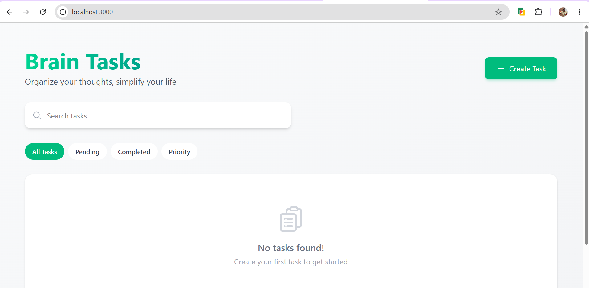
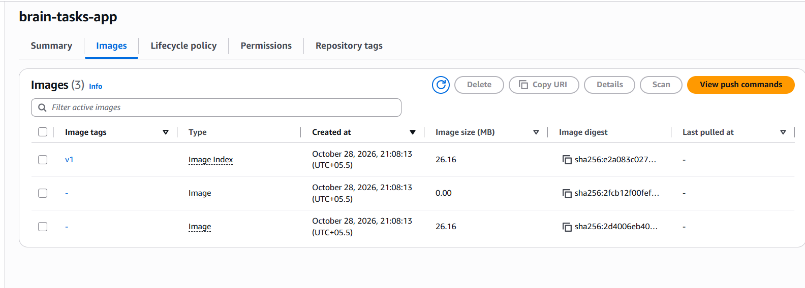
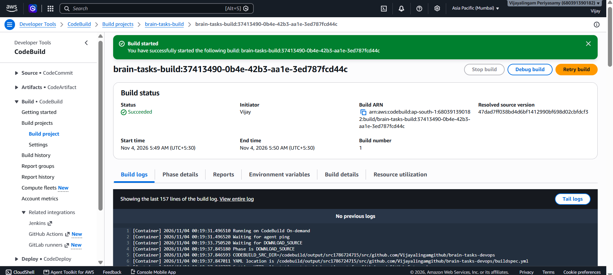
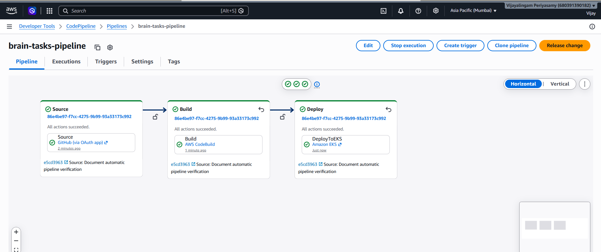
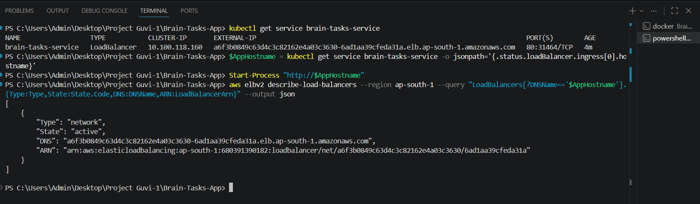
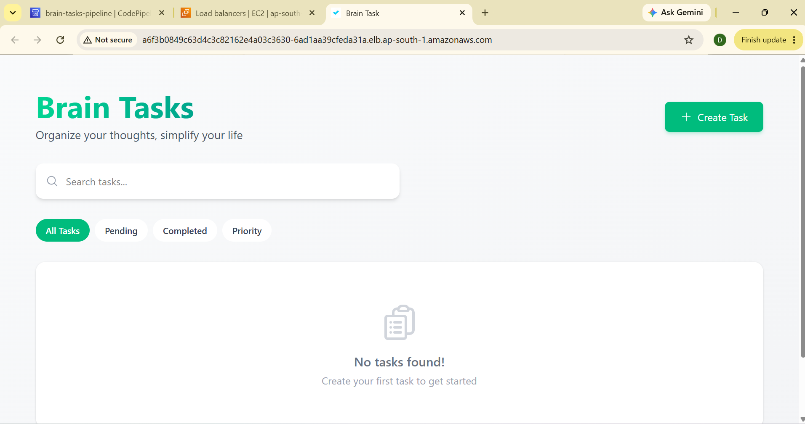
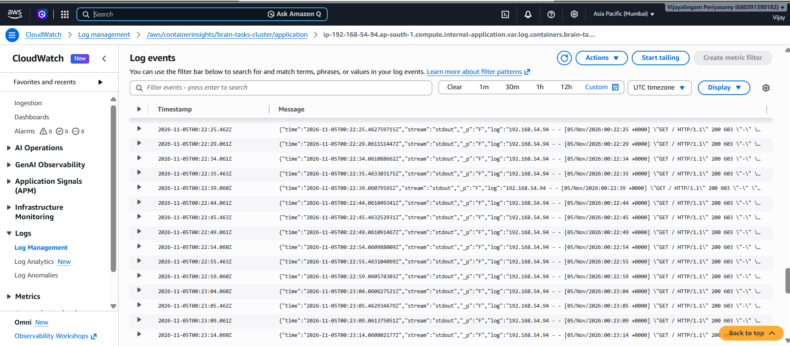

# Brain Tasks Application Deployment

GUVI DevOps Project 1 — Docker, Amazon ECR, Amazon EKS, CodeBuild, CodePipeline, and CloudWatch.

## Overview

This project deploys the Brain Tasks application using a Docker image served by Nginx on container port **3000**. A GitHub push triggers CodePipeline to build the image, push it to ECR, and deploy the generated Kubernetes manifests to EKS. A Network Load Balancer exposes the application on HTTP port **80**.

The upstream repository supplies compiled static files in `dist/`. There is no `package.json` or application source build step; Docker packages the existing production build.

## Submission details

| Item | Value |
|---|---|
| Author | Vijayalingam Periyasamy |
| Repository | https://github.com/Vijayalingamgithub/brain-tasks-devops |
| Upstream application | https://github.com/Vennilavanguvi/Brain-Tasks-App |
| Region | `ap-south-1` — Mumbai |
| ECR repository | `brain-tasks-app` |
| EKS cluster | `brain-tasks-cluster` |
| Managed node group | `brain-tasks-workers` |
| Worker capacity | Two `t3.medium` nodes |
| CodeBuild project | `brain-tasks-build` |
| CodePipeline | `brain-tasks-pipeline` — V2 |
| Kubernetes namespace | `default` |
| Deployment / Service | `brain-tasks-app` / `brain-tasks-service` |
| Replicas | 2 |

**Application URL recorded at verification:**

http://a6f3b0849c63d4c3c82162e4a03c3630-6ad1aa39cfeda31a.elb.ap-south-1.amazonaws.com

**Network Load Balancer ARN:**

```text
arn:aws:elasticloadbalancing:ap-south-1:680391390182:loadbalancer/net/a6f3b0849c63d4c3c82162e4a03c3630/6ad1aa39cfeda31a
```

These identify the deployment captured in the screenshots. Availability depends on keeping the AWS resources provisioned; recreating the load balancer changes its DNS name and ARN.

## Architecture

```text
GitHub main
    |
    v
CodePipeline Source
    |
    v
CodeBuild -- Docker build and push --> Amazon ECR
    |
    | BuildArtifact: rendered Kubernetes manifests
    v
CodePipeline EKS Deploy -- kubectl --> EKS Deployment (2 Pods)
                                         ^
                                         |
Browser --> Network Load Balancer :80 --> Service --> Nginx :3000

Build logs + deployment logs + container logs --> CloudWatch Logs
```

## Repository structure

```text
brain-tasks-devops/
├── dist/                    # Upstream compiled application
├── Dockerfile               # Nginx image with static files
├── nginx.conf               # Port 3000 and SPA route fallback
├── buildspec.yml            # Build, push, and render deployment manifests
├── k8s/
│   ├── deployment.yaml      # Replicas, image, probes, and resource settings
│   └── service.yaml         # Public NLB Service
├── screenshots/             # Project evidence
├── SCREENSHOTS.md           # Complete screenshot gallery
└── README.md
```

## Prerequisites

- Git, Docker Desktop using Linux containers, AWS CLI v2, `eksctl`, and `kubectl`.
- An AWS identity permitted to create the project resources and configure IAM roles.
- A GitHub account and access to the repository.
- A nonzero CodeBuild Linux/Small concurrency quota in Mumbai.

PowerShell is used for local commands. CodeBuild executes the Linux shell commands in `buildspec.yml`.

```powershell
aws --version
aws sts get-caller-identity
docker info
eksctl version
kubectl version --client
```

AWS resources incur charges. Provision EKS when ready to test and clean up after the review.

## 1. Clone and test Docker locally

For this completed project, clone the submission repository:

```powershell
git clone https://github.com/Vijayalingamgithub/brain-tasks-devops.git
cd brain-tasks-devops
docker build -t brain-tasks-app .
docker run --rm --name brain-tasks-app -p 3000:3000 brain-tasks-app
```

Open http://localhost:3000. Use another terminal for subsequent commands or press Ctrl+C to stop the container.

The Dockerfile copies `dist/` into Nginx's web root and installs `nginx.conf`. Nginx listens on 3000 and uses `try_files $uri $uri/ /index.html` to support client-side routes.



## 2. Store the image in Amazon ECR

```powershell
$AwsRegion = "ap-south-1"
$AwsAccountId = aws sts get-caller-identity --query Account --output text
$Registry = "${AwsAccountId}.dkr.ecr.${AwsRegion}.amazonaws.com"
aws ecr create-repository --repository-name brain-tasks-app --region $AwsRegion
aws ecr get-login-password --region $AwsRegion | docker login --username AWS --password-stdin $Registry
docker tag brain-tasks-app:latest "${Registry}/brain-tasks-app:v1"
docker push "${Registry}/brain-tasks-app:v1"
```

Skip repository creation when it already exists. The initial manual image is tagged `v1`; automated builds use the full Git commit ID.



## 3. Create EKS and verify nodes

Only run creation if the cluster does not already exist:

```powershell
eksctl create cluster --name brain-tasks-cluster --region ap-south-1 --nodegroup-name brain-tasks-workers --node-type t3.medium --nodes 2 --nodes-min 2 --nodes-max 2 --managed
aws eks update-kubeconfig --region ap-south-1 --name brain-tasks-cluster
kubectl get nodes
```

Both nodes must be `Ready`. The Deployment defines two replicas, CPU and memory requests and limits, and HTTP readiness and liveness probes on port 3000.

The final `k8s/service.yaml` requests an NLB through the cluster's legacy AWS Service integration:

```yaml
apiVersion: v1
kind: Service
metadata:
  name: brain-tasks-service
  annotations:
    service.beta.kubernetes.io/aws-load-balancer-type: "nlb"
spec:
  type: LoadBalancer
  selector:
    app: brain-tasks-app
  ports:
    - name: http
      port: 80
      targetPort: 3000
      protocol: TCP
```

The earlier screenshots show an initial Classic Load Balancer. The final verified deployment uses a Network Load Balancer. Do not migrate an existing Service's load balancer type in place; delete the old Service, wait for load balancer cleanup, and deploy the new manifest. This causes temporary public downtime.

## 4. Configure CodeBuild

Create `brain-tasks-build` in Mumbai with these settings:

| Setting | Configuration |
|---|---|
| Source | GitHub repository, branch `main` |
| Environment | Managed Ubuntu Standard image, Linux x86_64, EC2 on-demand |
| Image used | `aws/codebuild/standard:8.0` |
| Compute | Small — 2 vCPU and 4 GiB memory |
| Privileged mode | Enabled for Docker builds |
| Buildspec | `buildspec.yml` at repository root |
| Logs | CloudWatch, `/aws/codebuild/brain-tasks-build` |
| Pipeline output | `BuildArtifact` |

The service role needs CloudWatch log permissions, source access, and ECR push permissions. Scope ECR upload actions to the application repository; `ecr:GetAuthorizationToken` requires resource `*`. Pipeline executions also need access to the pipeline artifact bucket.

The buildspec:

1. Determines the AWS account and logs Docker into ECR.
2. Sets the image tag to `CODEBUILD_RESOLVED_SOURCE_VERSION`.
3. Builds and pushes the image.
4. Writes `rendered/deployment.yaml` with the new image URI and copies `rendered/service.yaml`.
5. Publishes both YAML files in the build artifact.



## 5. Configure CodePipeline and EKS permissions

Create V2 pipeline `brain-tasks-pipeline` in Mumbai with queued execution mode:

| Stage | Configuration |
|---|---|
| Source | GitHub `Vijayalingamgithub/brain-tasks-devops`, branch `main`, output `SourceArtifact` |
| Build | CodeBuild `brain-tasks-build`, input `SourceArtifact`, output `BuildArtifact` |
| Deploy | Amazon EKS, cluster `brain-tasks-cluster`, kubectl, namespace `default`, input `BuildArtifact` |
| Manifest paths | `rendered/deployment.yaml,rendered/service.yaml` |

The captured pipeline uses **GitHub via OAuth app**. A GitHub App connection can also be used, but is not the source provider shown in the successful execution evidence. Enable change detection for pushes to `main`.

The pipeline IAM role needs the standard artifact and CodeBuild permissions plus `eks:DescribeCluster`, the EC2 networking permissions required by the EKS action, and write access to `/aws/codepipeline/brain-tasks-pipeline` logs.

For a cluster with authentication mode `API` or `API_AND_CONFIG_MAP`, grant Kubernetes access:

```powershell
$PipelineRoleArn = "arn:aws:iam::680391390182:role/service-role/AWSCodePipelineServiceRole-ap-south-1-brain-tasks-pipeline"
aws eks create-access-entry --cluster-name brain-tasks-cluster --region ap-south-1 --principal-arn $PipelineRoleArn --type STANDARD
aws eks associate-access-policy --cluster-name brain-tasks-cluster --region ap-south-1 --principal-arn $PipelineRoleArn --policy-arn arn:aws:eks::aws:cluster-access-policy/AmazonEKSEditPolicy --access-scope type=namespace,namespaces=default
```

Skip access-entry creation if that principal already has an entry. Push a commit to `main` to execute the complete pipeline. The README verification commit `e5cd3963` passed Source, Build, and Deploy; the later NLB configuration is committed separately.



## 6. Verify the application and NLB ARN

```powershell
kubectl rollout status deployment/brain-tasks-app --timeout=180s
kubectl get pods
kubectl get service brain-tasks-service
$AppHostname = kubectl get service brain-tasks-service -o jsonpath='{.status.loadBalancer.ingress[0].hostname}'
Start-Process "http://$AppHostname"
aws elbv2 describe-load-balancers --region ap-south-1 --query "LoadBalancers[?DNSName=='$AppHostname'].{Type:Type,State:State.Code,DNS:DNSName,ARN:LoadBalancerArn}" --output json
```

Expect two ready Pods, an assigned hostname, type `network`, and state `active`. Allow time for load balancer provisioning and healthy targets before testing the URL.





## 7. CloudWatch monitoring

| Log purpose | Log group |
|---|---|
| Docker build and ECR push | `/aws/codebuild/brain-tasks-build` |
| Pipeline EKS deployment | `/aws/codepipeline/brain-tasks-pipeline` |
| Application container output | `/aws/containerinsights/brain-tasks-cluster/application` |

The CloudWatch Observability EKS add-on forwards container logs. This project uses the worker-node IAM permission method:

```powershell
$NodeRoleArn = aws eks describe-nodegroup --cluster-name brain-tasks-cluster --nodegroup-name brain-tasks-workers --region ap-south-1 --query "nodegroup.nodeRole" --output text
$NodeRoleName = ($NodeRoleArn -split '/')[-1]
aws iam attach-role-policy --role-name $NodeRoleName --policy-arn arn:aws:iam::aws:policy/CloudWatchAgentServerPolicy
aws eks create-addon --cluster-name brain-tasks-cluster --addon-name amazon-cloudwatch-observability --region ap-south-1
aws eks describe-addon --cluster-name brain-tasks-cluster --addon-name amazon-cloudwatch-observability --region ap-south-1 --query "addon.{Status:status,Issues:health.issues}" --output json
kubectl get pods -n amazon-cloudwatch
aws logs put-retention-policy --log-group-name /aws/containerinsights/brain-tasks-cluster/application --retention-in-days 1 --region ap-south-1
```

Skip add-on creation if it is already installed. In CloudWatch, open the application log group, filter streams for `brain-tasks-app`, and inspect HTTP request events. Readiness and liveness probes also generate `GET /` entries. Set appropriate retention for other project log groups as well.



## Troubleshooting

| Symptom | Resolution |
|---|---|
| Docker engine connection error | Start Docker Desktop and verify `docker info`. |
| Dockerfile or buildspec not found | Save the file at repository root; keep YAML manifests in `k8s/`. |
| `eksctl` not recognized | Install it, then restart the terminal or refresh PATH. |
| CodeBuild cannot queue any builds | Check applied Linux/Small quota in Mumbai and request an increase. |
| CloudFormation stack already exists | Check stack and EKS status; reuse an active cluster rather than recreating it. |
| Service not found during NLB replacement | Wait for the updated pipeline Deploy stage to recreate it. |
| Load balancer hostname pending | Inspect `kubectl describe service brain-tasks-service` and its events. |
| Deployment access denied | Check both pipeline IAM permissions and its EKS access entry. |

## Limitations and production improvements

The deployment demonstrates automated delivery and monitoring. It currently uses HTTP without a custom domain or TLS certificate. Add HTTPS, image vulnerability review, immutable image digests or enforced immutable tags, narrower workload IAM roles, and deployment rollback procedures before a production rollout. AWS recommends the AWS Load Balancer Controller for production load balancer management; this lab's NLB uses the legacy Service integration. The source repository provides only compiled assets, so source-level build and test coverage is outside this repository's scope.

## Screenshots

See [the complete screenshot gallery](SCREENSHOTS.md) for all 44 images, covering setup through final verification. Earlier images are historical setup evidence; final NLB evidence is in screenshots 42–44.

## Cleanup and cost control

Save evidence and confirm any live assessment requirements before cleanup. Stop or disable pipeline triggers before cleanup so later pushes do not deploy against a deleted cluster.

Delete the Kubernetes Service first to allow AWS to remove its load balancer:

```powershell
kubectl delete service brain-tasks-service
```

Wait until the associated NLB disappears from EC2 → Load Balancers, then delete the cluster:

```powershell
eksctl delete cluster --name brain-tasks-cluster --region ap-south-1 --wait
```

Verify cleanup of project worker instances, load balancers, NAT gateways, unused Elastic IPs, EBS volumes, and CloudFormation stacks. Investigate `DELETE_FAILED` stacks. Remove only resources belonging to this project. ECR images, CloudWatch log storage, and S3 artifacts may remain billable after cluster deletion; delete or retain them deliberately. EKS cannot be paused, and manually stopping worker instances does not stop the EKS control-plane charge.

## References

- [AWS ECR image workflow](https://docs.aws.amazon.com/AmazonECR/latest/userguide/getting-started-cli.html)
- [EKS deploy action](https://docs.aws.amazon.com/codepipeline/latest/userguide/action-reference-EKS.html)
- [CloudWatch Observability add-on](https://docs.aws.amazon.com/AmazonCloudWatch/latest/monitoring/install-CloudWatch-Observability-EKS-addon.html)
- [Delete an EKS cluster](https://docs.aws.amazon.com/eks/latest/userguide/delete-cluster.html)
